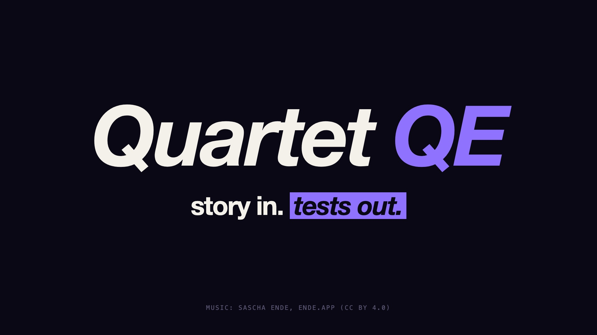

<p align="center">
  <a href="assets/quartet-qe-overview.mp4">
    
  </a>
  <br>
  <sub>49-second overview. Click to play. Music: Sascha Ende, ende.app (CC BY 4.0).</sub>
</p>

# Quartet QE

**An AI test agent that writes end-to-end tests from a user story, then proves its own work.**

Give it context about your systems and a story. It writes the tests for your APIs, Kafka topics, databases, web apps, mobile browsers and native apps. It checks its own code, runs it, and hands you one page to review. After the first recording the tests replay with no AI, so your pipeline is fast, free and deterministic.

1. **Give it context.** What your systems are and how your team builds.
2. **Give it a story.** From a file, Jira, Azure DevOps, GitHub or GitLab.
3. **It writes the tests.** For APIs, Kafka, databases, web, mobile web and native apps.
4. **You review.** One page, with anything that needs your attention at the top.

## Install

Pick one. Each needs Java 21 or newer.

**In Claude Code**, with nothing to clone:

```text
/plugin marketplace add goughliam1813/quartet-qe
/plugin install quartet-qe@quartet-qe
```

It asks for your tests folder and, if you want them, your Jira, Azure DevOps, GitHub, GitLab and Jenkins details. The first start fetches the matching release once and checks its SHA-256 before unpacking anything. See [`plugin/README.md`](plugin/README.md) for exactly what it runs, sends and fetches.

**In the Claude desktop app**, download the `.mcpb` file for your computer from the [latest release](https://github.com/goughliam1813/quartet-qe/releases/latest) (`mac-arm64` for Apple silicon Macs, `mac` for Intel Macs, `linux` or `linux-arm64`), double-click it and fill in the settings. The app warns that an extension has access to your computer. That is true of every local extension, and of Quartet: it runs on your machine and drives your browsers, devices and tests. [`SECURITY.md`](SECURITY.md) says what it can and cannot reach.

**From source:**

```bash
git clone https://github.com/goughliam1813/quartet-qe.git
cd quartet-qe
./get-started.sh
```

`get-started.sh` checks your machine, builds the tool, and offers a menu: watch the demo, connect your chat tool, or set up tests for your own product. It remembers that you have been before.

Each release lists a `SHA256SUMS` file and a software bill of materials. Check a download with `shasum -a 256 -c SHA256SUMS`, and with `gh attestation verify <file> --repo goughliam1813/quartet-qe` for the build provenance.

Or run it on a story directly:

```bash
./quartet-qe run --story stories/SHOP-142.md
```

```text
Context  26 files, 12 engineering principles
Story    SHOP-142: Checkout reserves stock and confirms the order (7 acceptance criteria)
Tests    6 written: 6 passed, 0 failed, 0 skipped
Review   reports/SHOP-142/review.html (ready to merge)
```

## Contents

- [Install](#install): as a Claude Code plugin, as a Claude desktop extension, or from source
- [Get started](GETTING-STARTED.md): run `./get-started.sh`, or follow the step-by-step guide (about 15 minutes)
- [What a test looks like](#what-a-test-looks-like)
- [How it works](#how-it-works)
- [What it can test](#what-it-can-test)
- [Why you can trust it](#why-you-can-trust-it)
- [Use the AI you are already chatting with](#use-the-ai-you-are-already-chatting-with)
- [Quick start](#quick-start)
- [Run report](#run-report)
- [Commands](#commands)
- [Configuration](#configuration)
- [Connectors](#connectors)
- [Jenkins](#jenkins)
- [AI providers](#ai-providers)
- [Repository layout](#repository-layout)

## What a test looks like

```java
ActResult order = agent.act("Place an order for 2 units of SKU-1001 for customer C-42",
        why("A customer checking out is the start of the reservation journey"),
        on("orders-api"),
        returns("orderId", "status"));

assertThat(order.get("status")).isEqualTo("RESERVED");
```

The agent decides how to act. Plain Java assertions decide whether it worked, so the AI never marks its own homework. There are no selectors, URLs or SQL in the test: it states intent, so a redesign changes a recording, not a test.

The same test can run on every screen with `@OnEverySurface("shop")`: desktop browsers, phone browsers, and native Android and iOS.

Other calls:

| Call | Purpose |
| --- | --- |
| `agent.act(instruction, why(...), on(target), returns(...))` | Do something and report named values. Every returned value must exist in a real tool result. |
| `agent.verify(claim, on(target))` | Ask the agent to check a claim against a system, for example a database row or a Kafka event. |

## How it works

```text
context/  +  story  ->  readiness check  ->  write tests  ->  static rules
                                                                   |
 review page  <-  prove (planted bugs)  <-  run  <-  second opinion
```

1. **Context.** The `context/` folder holds your engineering principles, service descriptions, OpenAPI and Pact contracts, event schemas, telemetry, test data and environments. The agent must read the parts that apply before it can finish.
2. **Story.** Read from a markdown file or from Jira, Azure DevOps, GitHub or GitLab. A readiness check lists questions about vague stories before any test is written (`check-story`).
3. **Write.** The agent writes JUnit 5 tests with AssertJ assertions, one package per story, keeping each test to one purpose.
4. **Check its own code.** The tests are compiled and checked against your engineering principles with static rules. Blocking findings are fixed before you see anything.
5. **Second opinion.** One independent review call looks through four lenses: Product Designer, Tech Lead, QA and DevOps.
6. **Run.** Tests run against your real environment. Verified steps are recorded.
7. **Prove (optional).** With `--prove`, bugs are planted in a test build and the tests must catch them.
8. **Review.** `reports/<story>/review.html` is a branded page you open in a browser: a plain verdict, then what needs your attention first, what each acceptance criterion proved, and the evidence. It is one file with nothing to fetch, follows your light or dark setting and prints cleanly. The same review is written as `review.md`, which is what a pull request description uses. Merge only after a person approves. After every `./gradlew test`, and in Jenkins, Quartet also writes `build/quartet-report/report.html`: the results of the run, what each act did step by step (including API responses), and a screenshot of each screen it touched, with click-to-enlarge. It says how many steps were replayed and how many needed the AI. Jenkins shows it as a "Quartet QE report" tab when the HTML Publisher plugin is installed, and always keeps it in the build artifacts. Set `QUARTET_SCREENSHOTS=off` to skip the screenshots.

### Record once, replay with no AI

The first run uses the AI (an API model, or the AI in your chat) to work out how to do each step, and saves each verified step to `recordings/`. From then on, tests replay those steps with no AI, which is the default mode.

| `QUARTET_MODE` | Behaviour |
| --- | --- |
| `replay` (default) | Uses recordings only. A missing recording fails with a message saying so. |
| `auto` | Replays when it can, and asks the AI only when a recording is missing or stale. `run` and `repair` set this for you. |
| `live` | Always asks the AI. |

If a step no longer works, for example a renamed button, it is handed back to the AI and re-recorded. It is never guessed. Recordings carry a replay policy version: after an upgrade that changes the replay rules, old recordings are re-recorded in `auto` mode and refused in `replay` mode, with a message saying which step stopped and why.

## What it can test

| Layer | How |
| --- | --- |
| **REST APIs** | Guided by your OpenAPI and Pact contracts. |
| **Kafka** | Produces and consumes events and validates them against JSON Schema. |
| **Databases** | PostgreSQL and MongoDB, read-only unless a target explicitly allows writes. |
| **Telemetry** | Reads metrics and checks them against your service objectives. |
| **Web** | Chromium and WebKit through Playwright, using each browser's accessibility tree. |
| **Phone browsers** | Playwright device emulation. |
| **Android** | Apps and on-device browsers through `adb`, with nothing installed on the device and no Appium. |
| **iOS** | A small XCTest runner in `native/ios` (needs Xcode). |

### Screens

| Surface | How it connects | Needs |
| --- | --- | --- |
| Desktop and phone browsers | Playwright | Nothing extra |
| Android apps and on-device browsers | `adb` directly | Android SDK platform tools, with `ANDROID_HOME` set |
| iOS apps and Safari | The runner in `native/ios` | Xcode |

Android's accessibility layer does not expose link addresses or page width, so tests of those use `kinds = "web"`. To see what the agent sees on a screen, run `observe --target <name>`.

A web target can use a hosted Chromium instead of a local one (browserless, Kernel, a Docker sidecar). Set `cdpUrl` on the device and the browser connects over CDP, through the same host guard as every other target:

```yaml
  shop-web:
    type: screen
    baseUrl: "http://localhost:18080"
    devices:
      desktop: {kind: web, engine: chromium, cdpUrl: "wss://your-browser-host/chromium?token=..."}
```

When a test fails, a screenshot of every screen it reached is saved next to the report, so you can see what the page looked like.

On a screen the agent can also count what is listed (`screen_count`) and, on web pages, read what the accessibility tree does not show (`screen_query`): a star rating kept in a CSS class, an image's alt text, a link's address. Counts and attributes come from the tool, never from the AI's eyes, and an answer may name a value after what it is (`bookCount` for the tool's `count`) but not borrow a number from an unrelated field.

## Why you can trust it

Every check below runs inside `run`. You only hear about one when it finds something.

- **No invented values.** Anything the AI reports must exist in a real tool result.
- **It reads before it writes.** It cannot finish without reading your principles, contracts and telemetry.
- **It checks its own code.** Tests are compiled and held to your engineering principles before you see them.
- **A second opinion.** An independent review looks through four lenses: Product Designer, Tech Lead, QA and DevOps.
- **Only verified steps are recorded**, and they replay with no AI.
- **Repairs cannot weaken a test.** No deleted assertions, no disabled tests, no changed expectations without evidence. A product bug is reported, not patched around.
- **Proof it catches bugs.** With `--prove`, bugs are planted in a test build and the tests must catch them.
- **Guard rails.** Only allow-listed hosts. Databases are read-only by default, enforced by a read-only transaction and a statement check, not just a setting. Generated tests cannot run programs, read files or environment variables, or open connections of their own. Downloads cannot reach private networks. Secrets are removed from prompts, logs and reports. See [SECURITY.md](SECURITY.md).

### Engineering principles

`context/engineering-principles/principles.yaml` turns your principles into rules, each set to `block`, `warn` or `off`. The bundled set covers emergent reuse, evolutionary design, small and simple tests, decoupling, data stewardship, production readiness and a walking skeleton that proves the layers connect first. Edit it to match your team.

### Watch the browser

By default tests run in a hidden browser, which is what CI needs. To see a test drive the browser on your own machine, add `-Pwatch`:

```bash
./gradlew test -Pwatch              # a real window, each step slowed down by 400 ms
./gradlew test -Pwatch -PslowMo=900 # slower, if it is still too quick to follow
```

A replay uses no AI, so without the slow-down it would flash by in a few seconds. Phone tests open a window sized like the phone. The `get-started.sh` menu has the same option. When the AI is writing and running tests in your chat, ask it to run them with `watch`, and it opens the window too. This needs a machine with a screen, and fails with a clear message on a server. Never use it in CI.

### Keeping tests small: reusable steps

Tests that each spell out the same journey get long, and every UI change means editing them all. Quartet's answer to the page object pattern is a **steps class**: a class in the `steps` package that holds journeys written once as `agent.act` calls, and any test calls them.

```java
// src/test/java/steps/Orders.java   (written once)
public final class Orders {
    private final TestAgent agent;
    public Orders(TestAgent agent) { this.agent = agent; }

    public ActResult placeOrder(String sku, int quantity) {
        return agent.act("Place an order for {{quantity}} units of {{sku}}", with("sku", sku), with("quantity", quantity),
                why("A customer checking out starts the order journey"), on("orders-api"), returns("orderId", "status"));
    }
}

// a test: a few lines, intent only
ActResult placed = new Orders(agent).placeOrder("SKU-1001", 2);
assertThat(placed.get("status")).isEqualTo("RESERVED");
```

- **One place to fix.** A renamed button is repaired in one step, not in every test that uses it.
- **One recording per step, not per test.** A recorded step is stored once (in `recordings/_shared`) and replayed by every test that uses it. Older per-test recordings still work. The same step on another device (iPhone, Android) is recorded separately.
- **Variables.** Write a step's instruction with `{{variables}}` and `with(...)` when a value is passed as it is into one field or request, such as a customer id or a quantity, so one recording serves every value. When the value changes which steps happen (which keys to tap, which screens to open), write it into the instruction instead, so each gets its own recording.
- **The rules see through steps.** A test is judged on everything it does, including the steps it calls, but a call to a step counts as one step however much it does. A problem inside a step is reported at the step. A step may take its reason as a parameter, `why(reason)`.
- **Repetition is flagged.** The same act written in two test classes gets a warning to move it into a steps class.
- **The AI uses them.** `list_steps` shows what exists and what each step does, `write_steps` adds one, and the AI is told to reuse before writing. They are committed in pull requests with the tests.

On the bookshop example, three test classes each wrote "open the home page and count the books" and one test wrote four near-identical acts. Moving them into one `Catalogue` steps class left tests that read as intent, no act written twice, and the same existing recordings still replaying. A steps class does not make a small suite shorter, because every act is still written once. What it prevents is the suite growing in step with every test that repeats a journey.

### Repairing brittle tests

```bash
./quartet-qe repair --file src/test/java/generated/shop142/OrderTest.java --selector 'generated.shop142.*'
```

The agent fixes a test that broke for a non-product reason, such as a changed label. An intent guard rejects any repair that deletes an assertion, disables a test or loosens an expectation. If the product is wrong, you get a bug report instead of a patch.

## Use the AI you are already chatting with

You do not need an API key. Quartet QE is also an [MCP](https://modelcontextprotocol.io) server, so the AI in your chat tool (Claude, Cursor, Copilot, or any tool that supports MCP) can write the tests itself. It uses the same context, rules, review and replay as an API model.

1. Open your tests repo (or this repo, to try the demo) in your chat tool. The server is already configured in `.mcp.json`:

   ```json
   {"mcpServers": {"quartet-qe": {"command": "./quartet-qe", "args": ["mcp"]}}}
   ```

   The first start builds the tool, which takes a minute. Approve the server when your tool asks.
2. To try the demo, start the sample shop in a terminal and leave it open: `./demo-shop.sh` (no Docker needed). For your own system, it must be running and reachable too. Quartet checks this before running tests and says what to start.
3. Ask: **"Write tests for stories/SHOP-142.md using Quartet QE."** The first time, Quartet asks where the tests should live (a new tests repo, an existing one, or this folder) and whether you want a Jenkins pipeline. It remembers your answers in `quartet-setup.yaml`. It never commits or pushes for you. To test a public website, say **"Test my site https://www.example.com using Quartet QE"** and describe what matters. The AI drafts the story with you, and Quartet creates the environment for that site itself. There is no file to write and nothing to restart. `AGENTS.md` tells the AI the order of work.
4. The AI reads your context, writes the tests, and hands them over. Quartet checks them, runs an independent review, runs the tests, and writes the review page.
5. You review `reports/<story>/review.html`. After that the tests replay with no AI at all.

You can see the whole path with no AI and no key. `./demo-chat.sh` starts the real server, a stand-in chat AI and the real sample system. The stand-in answers each model step from a script, so it shows the plumbing, not AI judgement.

How it works: when a test needs a model for a step, or the independent review needs one, Quartet writes the request to a shared folder. The chat AI reads it with `quartet_next_step`, answers with `quartet_answer_step`, and Quartet carries on. Every check, recording and guard rail is the same as with an API key.

Differences to know about:

- The independent review is a fresh conversation, but it is the same chat AI that wrote the tests. For a different model's opinion, use an API key for runs.
- Each model step is a round trip through the chat, so a first run is slower than with an API key. Replays are unaffected.
- Use an API key for unattended runs, such as a pipeline that writes tests for a story. Chat mode needs someone chatting.

## First-time setup, with the AI

A new project needs a few things before its first test: what the product is, the URLs and systems to test, what the AI should know about them, and optionally Jira or Azure DevOps, GitHub or GitLab, and Jenkins. Ask your AI: **"Help me set up Quartet QE for my product."**

It calls `quartet_onboarding`, which returns a checklist of what is done and what is missing, and works through the open items one at a time. It asks as little as possible up front (the product's name, and where the tests should live), picks sensible defaults, and keeps going.

It also **advises**. Only the product and one real system to test are needed to start, but each extra makes the tests better, so Quartet ranks what is missing, says why it matters, and lets you skip any of it:

| Add | What you get |
| --- | --- |
| An OpenAPI spec or event schemas | The biggest win. Tests assert your real fields, status codes and events instead of guesses |
| Service objectives and metrics | Tests check response-time objectives and metrics. Without them every review lists this as a gap |
| Synthetic test data | Repeatable tests that never use real personal data |
| Source code | The AI reads the code to settle what the contract leaves open |
| A git host and a remote for the tests repo | A pull request with the review page as its description |
| Jira, Azure DevOps, GitHub or GitLab stories | Stories read from where the team writes them, and results commented back |
| Jenkins | A pipeline Quartet builds, running the tests on every branch with no AI |

A `setup_strength` of Basic, Good or Great shows how much is in place, and the top suggestions also appear when a story starts and after the first results. For each answer it uses `quartet_configure` to write the right file, then `quartet_verify` to check the connection for real.

| Item | What the AI asks, and what Quartet writes |
| --- | --- |
| Product | Its name, owner and a sentence. Written to `context/manifest.yaml` |
| URLs and systems | Web, API, database and Kafka addresses. Written to the environment file, and only those hosts are allowed. Checked with `verify environment` |
| Context | An OpenAPI link (downloaded into `context/contracts/`), event schemas, notes on how the system works |
| Source code | Local folders or GitHub, GitLab and Azure DevOps repos the AI may read |
| Stories and git access | Jira, Azure DevOps, GitHub or GitLab settings. Checked by reading one real story, or the repo |
| Jenkins | Its address and user. Checked, then the job is created |

**Secrets never go through the chat.** The AI only ever names a variable, such as `JIRA_TOKEN`. You save the value yourself in a terminal:

```bash
./quartet-qe secret JIRA_TOKEN
```

The value is typed hidden, is never printed, and goes into `.env`, which git ignores. Quartet reads `.env` for connectors, environments and test runs. `quartet_secrets_status` shows which secrets are saved, by name only. If you paste a token into the chat anyway, Quartet's tools refuse to store it, but your chat tool may have kept it, so rotate it.

## Quick start

Needs JDK 21. No Docker.

### See it working with no key

```bash
./demo.sh
```

The demo runs against real Kafka, PostgreSQL, MongoDB and Chromium, using a sample shop called ShopFlow. It uses a scripted stand-in for the AI, so it shows the framework working rather than AI judgement. It runs the full journey: a vague story gets questions, a good story gets tests and a review page, a second run replays with no AI, and a brittle test is repaired without being weakened.

### Start a tests repo

Tests live in their own repo, one per product or team, not in this one.

```bash
./new-tests-repo.sh ../my-product-tests
```

That gives you a lean repo with only what is yours: `quartet.yaml`, a `README.md` about your product (rebuilt from the repo's own files as stories and results change), `context/` with your environment, the tests, recordings and reports as they appear, and the Gradle wrapper. Quartet QE is installed once per machine (at `~/.quartet/current`, done for you), so no scripts, principles or framework are copied in. Quartet's built-in engineering principles and playbooks apply as they are, and `./quartet-qe defaults --copy <path>` copies one in when you want to change it. A `Jenkinsfile` and `connectors.yaml` are created only when you ask for Jenkins or an integration. Helper commands: `./quartet-qe get-started`, `./quartet-qe secret NAME` and `./quartet-qe ai-key`. Jenkins fetches the version named in `quartet.yaml` when an agent has no install.

In that repo:

```bash
./quartet-qe ai-key         # saves your key to .env, input hidden
./quartet-qe doctor          # checks the AI, context and environment
./quartet-qe run --story stories/MY-STORY.md
./gradlew test               # replays with no AI
```

## Run report

One page for the last run, built from the build's own JUnit XML and an audit of every `agent.act`: what the tests decided, how long each took, what the AI did, and what it cost. Every number comes from the build, never from a model.

```bash
./quartet-qe report --results e2e-tests/build/test-results/test
# Report   e2e-tests/build/quartet-report/report.html
```

With `--pr 42` the same numbers post as a comment on a GitHub pull request, using the token in `connectors.yaml`. `--dry-run` prints the comment without posting it.

## Commands

```text
run --story <ref>          Write tests for a story, run them, and produce one page to review
    [--prove]              Also plant bugs to prove the tests catch them
    [--no-run]             Write the tests without running them
publish --story <ref> --code <github|gitlab|ado> [--ci <jenkins|github|gitlab|ado>]
                           Run, then open a pull request with the review as its description
repair --file <Test.java> --selector <test filter>
                           Fix a brittle test without weakening it
setup-jenkins [--repo-url <url>]
                           Create the Jenkins job for this tests repo (and the Jenkinsfile if missing)
report [--results <dir>] [--audit <acts.jsonl>] [--out <report.html>] [--pr <number>] [--dry-run]
                           One page for the last run; --pr posts it as a GitHub comment
check-story --story <ref>  List questions about a story before writing tests
observe --target <name> [--device <name>] [--path /]
                           Show what the agent sees on a screen
context-search --query "text"
doctor                     Check the AI, context and environment setup
mcp                        Serve Quartet QE to a chat tool over MCP, so the AI you are chatting with writes the tests (no API key)
```

Story references: `path/to/story.md`, `jira:KEY-1`, `ado:123`, `github:45`, `gitlab:7`. Any command accepts `--environment <file>`.

`publish` runs the story, commits the tests to a new branch in your code host, opens a pull request with the review as its description, and can start your CI pipeline and follow it to the end. A person still approves the pull request.

## Configuration

| File | Purpose |
| --- | --- |
| `quartet.yaml` | Where the agent finds the context, environment, connectors, reports and how to run your tests |
| `context/environments/*.yaml` | Targets the tests can reach, and the guard rails |
| `connectors.yaml` | Jira, Azure DevOps, GitHub, GitLab and Jenkins addresses. Tokens come from environment variables |
| `.env` | Your AI provider and key. Never committed |

An environment file lists targets and a guard:

```yaml
guard:
  production: false
  allowHosts: [localhost, 127.0.0.1]   # tests can only reach these hosts
targets:
  orders-api:
    type: api                          # api | screen | kafka | postgres | mongo
    baseUrl: "${ORDERS_API_URL:-http://localhost:18080}"
    context: [contracts/openapi/orders-service.yaml]
  shop-web:
    type: screen
    baseUrl: "${SHOP_WEB_URL:-http://localhost:18080}"
    devices:
      desktop: {kind: web, engine: chromium}
```

## Connectors

| System | Reads stories | Comments the review back | Opens pull requests | Starts pipelines |
| --- | --- | --- | --- | --- |
| Jira | yes | yes | | |
| Azure DevOps | yes (work items) | yes | yes | yes |
| GitHub | yes (issues) | yes | yes | yes (Actions workflow) |
| GitLab | yes (issues) | yes | yes | yes |
| Jenkins | | | | yes, and creates the job |

## Jenkins

Quartet QE sets Jenkins up for you. Put your Jenkins address, user and API token in `connectors.yaml`, then from the tests repo:

```bash
./quartet-qe setup-jenkins
```

It writes the `Jenkinsfile` if the repo has none, creates any missing folders, and creates a multibranch pipeline job pointed at the repo. Running it again updates the job rather than duplicating it. Jenkins then builds every branch and pull request, and each build replays the recorded steps with no AI.

`publish --ci jenkins` does the same before it starts a build: it makes sure the job exists, asks Jenkins to scan for the new branch, waits until Jenkins has found it, starts a build and follows it to the end.

Needs the Pipeline: Multibranch, Git and Folders plugins, which most installations already have. For a private repo, add a Jenkins credential and set `credentialsId`. The repo address is taken from `origin`, and a username or token in it is refused. The `Jenkinsfile` only needs an AI key for the optional stage that writes tests for a story.

## AI providers

Set these in `.env`:

| `AI_PROVIDER` | Notes |
| --- | --- |
| `anthropic` | Needs `AI_API_KEY` |
| `openai` | Needs `AI_API_KEY` and `AI_MODEL` |
| `azure-openai` | Also needs `AI_BASE_URL` |
| `gemini` | Needs `AI_API_KEY` and `AI_MODEL` |
| `openai-compatible` | Ollama, vLLM, LiteLLM or an internal gateway. Needs `AI_BASE_URL` |
| `host` | The AI in your chat tool, over MCP. No key. Set for you by `./quartet-qe mcp` |

Busy or rate-limited services are retried patiently, with progress shown. The agent never needs a vendor-specific feature, so any model that can call tools will work, though test quality depends on the model.

## Repository layout

| Folder | Purpose |
| --- | --- |
| `quartet-core` | AI providers and the agent loop |
| `quartet-runtime` | `agent.act`, `agent.verify`, screens, recordings, and drivers for API, Kafka, PostgreSQL and MongoDB |
| `quartet-generator` | The command line tool, connectors, checks and repair |
| `skeleton` | The starting point for a tests repo |
| `native/ios` | The iOS runner |
| `context`, `stories`, `demo-shopflow`, `e2e-tests`, `reports` | The ShopFlow demo |
| `assets` | README media |
| `AGENTS.md`, `.mcp.json` | Instructions and server settings for chat tools. Copied into every new tests repo |
| `GETTING-STARTED.md` | The step-by-step guide |

Built with Java 21 and Gradle. `./demo.sh` shows the framework with a scripted stand-in for the AI. `./demo-chat.sh` shows the chat path.

Run the unit tests with:

```bash
./gradlew :quartet-core:test :quartet-runtime:test :quartet-generator:test
```

## Licence

MIT. See [LICENSE](LICENSE).

The quality model is based on Liam Gough's writing on quality engineering.
